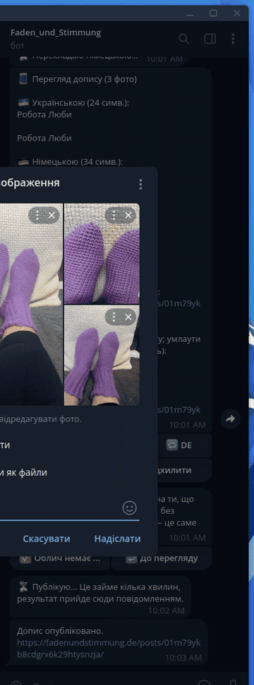
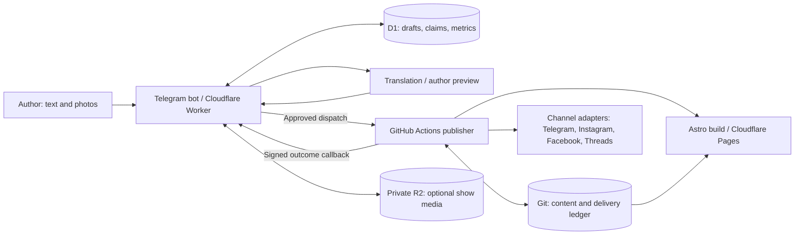

# Faden und Stimmung

A publishing platform used by a volunteer handmade circle in Landshut, Germany.
The author writes Ukrainian text and uploads authentic photos in a private Telegram bot;
she reviews the German translation and approves publication. One pipeline delivers the
approved content to Telegram, Instagram, Facebook, Threads and a bilingual static website.
The project now supports the author's brand and audience growth beyond the local circle.

[Website](https://fadenundstimmung.de) · [Telegram](https://t.me/Faden_und_Stimmung) ·
[Operations and test deployment](docs/operations.md) · [Architecture](docs/02-architecture.md)

## See the real workflow



[Watch the MP4](docs/assets/demo.mp4). Recorded on the private test channel on 2026-11-13:
three photos → `/done` → bilingual preview → consent → publish → album and German reply.
The 29-second recording is edited: the file picker and a transient failed attempt were removed.
It demonstrates the interaction, not end-to-end publication latency.

## Engineering behind the workflow



- **Separate runtimes:** the Worker handles interactive editing and claims; Actions performs
  image processing, Git commits and network delivery. The author can work without Git or Markdown.
- **Recoverable publishing:** stable draft IDs and a per-operation ledger let reruns skip saved
  deliveries. D1 claims prevent double-click dispatches. Remote acceptance followed by a lost
  ledger write remains an ambiguity window; [recovery](docs/operations.md#failure-and-recovery)
  requires checking the destination before retrying.
- **Pluggable channels:** the domain defines ports and capabilities; adapters render and deliver.
  Core storage and runner interfaces allow future implementations without network dependencies.
- **Human control:** previews, edits, consent checks and explicit approval precede publication.
  Content records declare `human`, `ai-assisted` or `ai-generated` provenance.
- **Shared source:** approved posts, works and disclosed AI shows feed channels and the website.
  Test posts are excluded from public site pages and Meta deliveries.

## Evidence and usage

Telegram has been live since 2026-10-27. A live three-photo carousel was verified across
Instagram, Facebook and Threads on 2026-11-13; its retry skipped the existing Telegram delivery
([runbook evidence](docs/instagram-runbook.md#first-live-checks-record-outcomes-in-the-prtask)).
The T33 handoff records a green CI run with 1,971 tests, typechecking, builds, lint, formatting,
workflow validation, a publisher dry run and secret scanning (run `43446665835`).
These are verification results, not audience or revenue figures.

Tenant usage is available through operator `/stats`: publications in the last 28 days,
median draft-to-publication time, edits per published draft and eventual delivery success.
**A real `/stats` snapshot has not yet been supplied for this README.** No production usage
numbers are inferred from test fixtures or Git history. Test and live deliveries share the report;
workflow averages have a post-migration sample size and there is no historical backfill.
See [metric definitions and limits](docs/usage-metrics.md).

## Design decisions and trade-offs

| Decision | Benefit | Cost / boundary |
| --- | --- | --- |
| [TypeScript monorepo](docs/decisions/001-typescript-monorepo.md) | Shared domain contracts across runtimes | Workspace builds and dependency discipline |
| [Worker + D1](docs/decisions/002-bot-hosting.md) | Always-on webhook, SQL state, no server maintenance | Runtime limits keep heavy processing elsewhere |
| [Actions + Git ledger](docs/decisions/003-publish-in-github-actions.md) | Auditable content, visible retries | Queue latency; no atomic transaction with external APIs |
| [Ports and adapters](docs/decisions/007-ports-and-adapters.md) | Networks and stores have explicit seams | More interfaces than a one-off script |
| [Tenant-aware data](docs/decisions/006-multi-tenancy.md) | Isolation keys and replaceable stores/runners | One deployed tenant; no SaaS onboarding or billing |
| [Static Astro site](docs/decisions/011-website.md) | Same content, static delivery | Rebuild after publication; site can lag after a failed deploy |

## Run locally

Use Node 22 (`.nvmrc`) and pnpm 12.14.0 (`packageManager`). From the repository root:

```sh
pnpm install --frozen-lockfile
pnpm lint
pnpm typecheck
pnpm test
pnpm build
pnpm --filter @handmake/publisher exec tsx src/cli.ts --dry-run "$PWD/fixtures/sample-payload.json" --root "$PWD"
```

The sample has no photos and needs no service credentials; the dry run writes under a temporary
directory and sends nothing. A payload with file IDs downloads photos and needs bot credentials.
See [deploy from scratch](docs/operations.md#deploy-a-test-installation-from-scratch) for an isolated test installation.

| Path | Responsibility |
| --- | --- |
| `packages/core` | Domain schemas, ports, state and tenant config |
| `packages/channels` | Renderers, network adapters and capabilities |
| `packages/stores` | Git-backed content and ledger persistence |
| `packages/ai` | Translation and generation adapters |
| `apps/bot` | Private author workflow, D1, webhooks and scheduled jobs |
| `apps/publisher` | Actions CLI: processing, publication and recovery |
| `apps/site` | Bilingual Astro site built from approved content |
| `config/tenants`, `content` | Tenant settings and published artifacts |

## Operational boundaries

Secrets stay in ignored `.env`, GitHub Secrets and Worker secrets. The bot admits allow-listed
operators; callbacks have a separate HMAC key. Drafts and private media are distinct from public
Git content. Participant registration is outside this pipeline; later contest/comment features
have separate consent, retention and private-name handling. This is a single-tenant production
installation with tenant-aware architecture, not a hosted multi-tenant product.

[Operations](docs/operations.md) · [MVP acceptance](docs/e2e-mvp.md) ·
[Current acceptance](docs/e2e-v7.md) · [Tasks](docs/03-tasks.md) · [ADRs](docs/decisions/)
